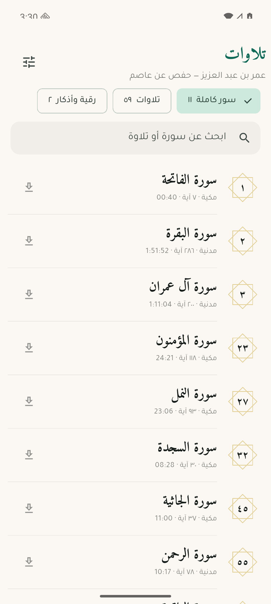
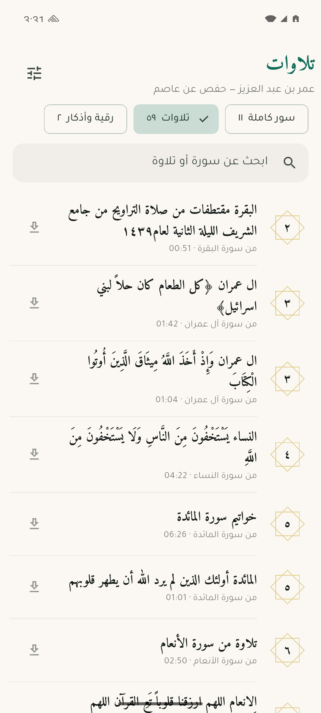
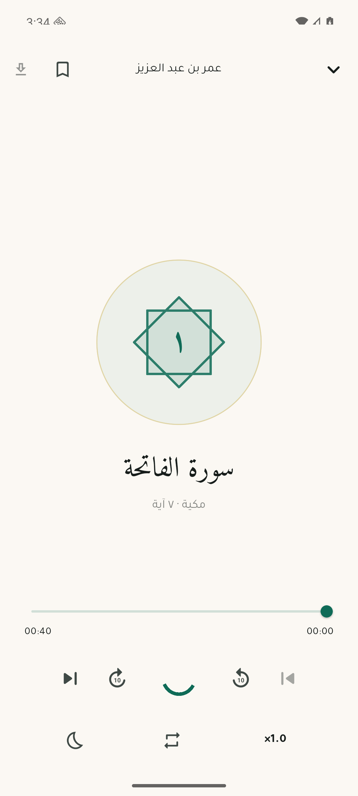
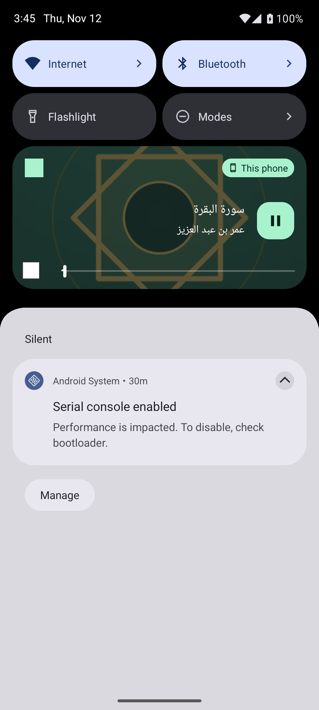

# تلاوات عمر بن عبد العزيز

An Android and iOS app for listening to the recitations of Sheikh عمر بن عبد العزيز.
Free, no ads, no accounts, no tracking, and fully usable offline once recordings
are downloaded.

<p align="center">
  
  
  
  
</p>

## Download

Grab the APK from the [latest release](https://github.com/hammale2003/tilawat-omar-ibn-abdulaziz/releases/latest).
Use the `arm64` file unless the phone is very old.

## What's in it

**72 recordings, 8.5 hours**, in three sections:

| Section | Count | Length | What it is |
|---|---|---|---|
| سور كاملة | 11 | 4.7 h | Surahs recorded complete: الفاتحة، البقرة، آل عمران، المؤمنون، النمل، السجدة، الجاثية، الرحمن، الواقعة، الإنسان، الضحى |
| تلاوات | 59 | 3.4 h | Excerpts from tarawih and tahajjud prayers, خواتيم and فواتح of surahs, drawn from ~35 different surahs |
| رقية وأذكار | 2 | 0.4 h | الرقية الشرعية (18 min), آيات السكينة (6 min) |

**There is no complete mushaf by this reciter**, and this is not an oversight.
He is absent from mp3quran.net entirely (all 244 reciters checked); the
archive.org and IslamWay copies hold only the surahs above; surahquran.com
advertises "the whole Mushaf in his voice" but the file it links to is the
10-surah archive.org item. The app therefore presents what exists rather than
pretending to a mushaf it does not have.

## Adding recordings

Everything lives in `assets/catalog.json`. Adding a recording is a data edit,
not a code change:

```json
{
  "id": "t074_36",
  "section": "clips",
  "surah": 36,
  "title": "تلاوة من سورة يس",
  "url": "https://.../036.mp3",
  "bytes": 12345678,
  "secs": 1234
}
```

- `id` must be unique and stable — it keys the saved playback position, the
  bookmark and the downloaded file. Changing it orphans all three.
- `section` is `surahs`, `clips` or `special`.
- `surah` may be `null` for a recording not tied to one surah.
- `bytes` drives the download-size label and the progress bar; `secs` is shown
  before playback starts. Both should be accurate.

When the reciter sends his own recordings, drop them in and they appear.

## Build

Requires Flutter 3.50+, JDK 21, and Android SDK platform **37** — `compileSdk`
is pinned to 37 in `android/app/build.gradle.kts` rather than following
`flutter.compileSdkVersion` (36), because `permission_handler_android` refuses
to build against anything lower. `targetSdk` and `minSdk` still follow Flutter's
defaults; only the compile-time API level is raised.

```
sdkmanager --install "platforms;android-37.0" "build-tools;37.0.0"
```

```
export JAVA_HOME=/opt/homebrew/opt/openjdk@21
flutter pub get
flutter analyze && flutter test
flutter build apk --debug      # or --release for the store
```

The debug APK lands in `build/app/outputs/flutter-apk/app-debug.apk` and can be
sent to any Android phone and installed directly — no Play Store account needed.

## Identity

Both platforms use the same application identifier: **`com.hammale.tilawat`**.

The original `com.tilawa.tilawa` had to be abandoned — Apple refused to register
it because bundle identifiers are globally unique across every developer
account, and that one was already taken. It was changed before anything was
published, since on the App Store an identifier is permanent.

Changing it on Android means an installed build under the old identifier is a
*different app* to the system: it will not update, and must be uninstalled
first.

## Permissions

The app requests exactly six, and every one is needed for playback:

| Permission | Why |
|---|---|
| `INTERNET` | fetch the audio |
| `ACCESS_NETWORK_STATE` | the audio plugin checks connectivity before buffering |
| `WAKE_LOCK` | keep playing with the screen off |
| `FOREGROUND_SERVICE` | the playback service |
| `FOREGROUND_SERVICE_MEDIA_PLAYBACK` | its Android 14+ typed form |
| `POST_NOTIFICATIONS` | show the lock-screen playback control |

No contacts, location, camera, microphone, storage or device identifiers.
Verify after any dependency change:

```
aapt2 dump permissions build/app/outputs/flutter-apk/app-arm64-v8a-release.apk
```

`POST_NOTIFICATIONS` is a **runtime** permission on Android 13+, not just a
manifest entry. Declaring it is not enough: without the runtime grant the media
notification is never posted, which means no lock-screen controls and no
foreground service, so the system is free to kill playback in the background.
The app asks for it on first play — `_ensureNotificationPermission` in
`lib/player/player.dart` — rather than at launch, so the prompt arrives with a
visible reason. Playback still works if the listener declines; only the
lock-screen control is lost.

### iOS

iOS needs more than Android does, and none of it can be skipped:

1. **Xcode** and **CocoaPods** (`brew install cocoapods`). The audio plugins
   have native iOS code, so the build fails without pods.
2. **An Apple ID signed into Xcode** — Settings → Accounts → +. Apple requires
   every app on a device to be signed; `security find-identity -v -p codesigning`
   reporting "0 valid identities" means this step has not been done.
3. **The iPhone connected by cable and trusted.**

Then:

```
flutter build ios --no-codesign     # compile check, no Apple ID needed
flutter run --release -d <device>   # install onto a connected iPhone
```

With a **free** Apple ID the installed app stops working after 7 days and must
be reinstalled from the Mac — an Apple restriction, not a build setting. The
$99/year Developer Program lifts it and enables TestFlight, which installs over
the air and lasts 90 days.

An `.apk` cannot be installed on an iPhone under any circumstances; iOS only
accepts apps signed through Apple's own system.

## Layout

```
lib/
  data/      models, catalogue loading, preferences, downloads
  player/    the audio service (queue, repeat, sleep timer, resume)
  ui/        theme, home, player, settings, shared widgets
assets/
  surahs.json    all 114 surahs: Arabic name, ayah count, Makki/Madani
  catalog.json   the recordings: what they are and where the audio lives
  fonts/         Amiri and Tajawal (SIL Open Font License)
docs/            store listing copy, privacy policy
design/          app icon source + rendered screens
```

### Notes on a few decisions

**A "recording" is the unit, not a "surah."** Since no complete mushaf exists,
modelling the catalogue as surah→file would have forced every excerpt to
masquerade as a surah. A `Recording` may be a whole surah, an excerpt that knows
which surah it came from, or neither.

**The queue is managed by hand** in `player/player.dart` rather than with a
playlist audio source. The playlist APIs have changed between just_audio
majors; one recording at a time with an explicit "what plays next" rule is both
version-proof and easier to reason about for repeat modes. The queue is whatever
section you are browsing, so "next" moves through what you can see.

**Downloads write to `.part` first** and are renamed into place only when
complete, so an interrupted download can never be mistaken for a good file.
Resumption uses a Range request; if the server answers 200 instead of 206 the
partial file is discarded rather than appended to.

**Nothing leaves the device.** No backend, no analytics, no accounts. The only
network traffic is fetching the audio itself.

## Licences

- Code: yours.
- Fonts: Amiri and Tajawal, SIL Open Font License (`assets/fonts/*-OFL.txt`).
- Surah metadata: Quran.com API.
- Audio: permission obtained from the reciter. Keep a written copy — stores act
  on rights complaints.
